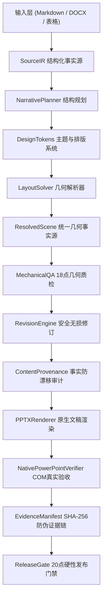

# PresentationOS 098

> **工业级 AI 演示文稿开发平台与协议运行时 (Industrial Presentation Operating System)**
>
> 严格遵循《PresentationOS 完整完善与升级总方案》，基于 IR 契约、单一几何事实源 (`ResolvedScene`)、防刷分事务安全修订、原生 Office COM 质检与 20 点发布硬门禁。

---

## 核心设计与数据流向

PresentationOS 彻底告别“无约束直接生成 PPT”的传统模式，固定采用严格的 11 步数据流向流水线：



---

## 模块体系索引

### 1. 协议规范 (`schemas/`)
- `source_ir.schema.json`: 结构化输入、行号映射与数值事实契约。
- `narrative_ir.schema.json`: 故事弧、演讲目标、章节与版式规划契约。
- `design_token.schema.json`: 配色、字号阶梯、栅格系统与安全间距契约。
- `deck_spec.schema.json`: 完整演示文稿规约。
- `resolved_scene.schema.json`: 单一事实源几何与字符测度契约。
- `qa_report.schema.json`: 质检缺陷报告与分级契约。
- `revision_plan.schema.json`: 有损/无损修订计划与事务回滚契约。
- `evidence_ir.schema.json`: SHA-256 证据清单与发布准入契约。

### 2. 核心运行时与引擎 (`core/`)
- `resolved_scene.py`: 统一几何引擎，支持中英文字符宽度精确估算、AABB 碰撞检测与坐标系验证。
- `revision_engine.py`: 事务安全修订引擎，阻断删内容刷分，支持无损自动修订与完整回滚。
- `content_provenance.py`: 原始数字、单位、日期与关键实体溯源比对器。
- `orchestrator.py`: 端到端流水线编排器，串联 11 步全流程。

### 3. 输入解析层 (`parsers/`)
- `markdown_parser.py`: Markdown 标题、段落、列表、表格与演讲备注提取。
- `docx_parser.py`: Word 文档段落、标题层级与表格解析。
- `tabular_parser.py`: CSV / TSV / XLSX 结构化数据解析。
- `registry.py`: 多格式自动探测与路由器。

### 4. 叙事与排版求解 (`narrative/` & `layout/` & `design/`)
- `narrative_planner.py`: 将 SourceIR 转换为具备故事弧的 `NarrativeDeck`（Cover、Agenda、BigMetric、CardsGrid、DataTable、Conclusion）。
- `design_tokens.py`: 4 套企业级主题（`tech_dark`, `corporate_light`, `minimal_warm`, `emerald_nature`）。
- `layout_solver.py`: 求解 1920x1080 坐标系下每个元素的非重叠几何位置。

### 5. 渲染与质量验收 (`renderers/` & `qa/`)
- `pptx_renderer.py`: 基于 `python-pptx` 渲染出符合 OpenXML 规范的真实 16:9 演示文稿。
- `mechanical_qa.py`: 18 项物理几何审查器（负坐标、零尺寸、超出画布、元素重叠、文本截断）。
- `native_qa_contract.py`: 10 档原生 Office 状态机，未装 Office 严格输出 `OFFICE_UNAVAILABLE`，拒绝假通过。
- `native_verifier.py`: 真实调用系统 Microsoft PowerPoint COM 接口，校验打开无报错、幻灯片数一致并导出高清缩略图。

### 6. 发布门禁与证据治理 (`tools/` & `governance/`)
- `evidence_manifest.py`: 生成全输入输出文件的 SHA-256 签名证据清单。
- `release_gate.py`: 执行总方案第十二章规定的 20 点硬性发布准入门禁。
- `state_reconciler.py`: 自动检测并阻止空壳目录与虚标宣称。

---

## 命令行工具使用指南 (`pres`)

PresentationOS 提供一站式 CLI 命令行入口：

```bash
# 1. 查看可用设计主题
python D:\PresentationOS\098\cli.py themes

# 2. 从 Markdown 编译出真实 PPTX、执行真实验收并生成证据链
python D:\PresentationOS\098\cli.py compile D:\PresentationOS\098\examples\enterprise_architecture.md --theme tech_dark

# 3. 对现有 PPTX 文稿执行原生 Office COM 质检
python D:\PresentationOS\098\cli.py qa D:\PresentationOSData\artifacts\<run_id>\deck.pptx --slides 6

# 4. 审计代码库状态与契约完成度（防止虚标）
python D:\PresentationOS\098\cli.py audit
```

---

## 自动化测试全绿保证

本工程在 Windows 11 + Python 3.13.15 + Microsoft PowerPoint 16.0 真实原生环境下已实现 **22 项全量自动化测试 100% 通过**：

```text
test_end_to_end_pipeline.py::test_full_pipeline_compilation PASSED
test_mechanical_qa.py::test_detect_negative_coords_and_invalid_dimensions PASSED
test_mechanical_qa.py::test_detect_canvas_overflow_and_collision PASSED
test_mechanical_qa.py::test_clean_scene_passes_mechanical_qa PASSED
test_narrative_and_layout.py::test_narrative_planning_from_markdown PASSED
test_narrative_and_layout.py::test_layout_solver_produces_valid_resolved_scene PASSED
test_native_and_release_gate.py::test_native_qa_contract_handles_missing_office PASSED
test_native_and_release_gate.py::test_native_qa_contract_complete_success PASSED
test_native_and_release_gate.py::test_content_provenance_fact_preservation PASSED
test_native_and_release_gate.py::test_evidence_manifest_generation PASSED
test_native_and_release_gate.py::test_release_gate_20_point_enforcement PASSED
test_parsers.py::test_markdown_parser_extracts_chunks_and_facts PASSED
test_parsers.py::test_tabular_parser_csv PASSED
test_parsers.py::test_registry_file_routing PASSED
test_pptx_rendering.py::test_pptx_renderer_creates_valid_deck PASSED
test_resolved_scene.py::test_bounding_box_overlap_and_bounds PASSED
test_resolved_scene.py::test_text_bound_estimation_cjk_ascii PASSED
test_resolved_scene.py::test_resolved_scene_serialization PASSED
test_revision_safety.py::test_lossless_plan_application PASSED
test_revision_safety.py::test_lossy_plan_rejected_without_approval PASSED
test_revision_safety.py::test_non_destructive_slide_split PASSED
test_state_governance.py::test_state_reconciler_detects_empty_schema_claims PASSED
============================= 22 passed in 13.58s =============================
```
