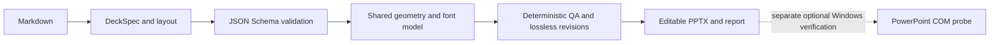

# PresentationOS

An experimental presentation compiler and a set of TypeScript/.NET components for editable PowerPoint workflows.

[](https://github.com/bobo123546/PresentationOS/actions/workflows/ci.yml)
[](LICENSE)

**0.1.2-alpha · Developer preview · Full platform release status: NOT_READY**

The supported CLI turns a documented Markdown subset into PPTX, validates its DeckSpec, and runs deterministic geometry and visual rules. Automatic revisions retain source text. QA failures return a nonzero exit code. Reports describe the checks actually attempted; they are not a guarantee of appearance or correctness for arbitrary documents.

## Quick start

Use a supported Node.js LTS release (22.13+ or 24) and pnpm 12.5.1. The Markdown CLI does not require PowerPoint, an API key, Python, or .NET.

```sh
git clone https://github.com/bobo123546/PresentationOS.git
cd PresentationOS
pnpm install --frozen-lockfile
pnpm --workspace-concurrency=1 -r --if-present build
node apps/cli/dist/index.js compile tools/vertical-slice/sample.md ./sample.pptx
node apps/cli/dist/index.js qa tools/vertical-slice/sample.md ./sample.qa.json
node apps/cli/dist/index.js audit
```

Use new output paths: existing files, links and input aliases are rejected. Without an explicit output, each invocation creates a separate run directory. Set `PRES_DATA_DIR` to choose its data root; the Windows default is `D:\PresentationOSData`. Source files are never used as default report paths.

Supported input includes headings, paragraphs, bullets, quotes and pipe tables. Long content and tables are paginated. Unsupported renderer blocks fail explicitly. Markdown extensions, complex table layouts and unsupported SVG rendering require further development.

Each H1 or H2 starts a visible slide section; the first H1 also supplies the document title. A title-only H1 therefore produces a title page. Only the first valid separator row after a table header is treated as Markdown syntax; later rows containing `---` are retained as data. XML-forbidden characters in titles, text, table cells and chart labels block compilation. Valid Unicode, including emoji, is preserved.

The legacy `tools/vertical-slice/markdown-to-deck.mjs` command delegates to the same validated compiler and retains its `.qa.json` report suffix. It applies the same refusal to overwrite input, output or report files.

## Architecture



- `apps/cli`: compile, qa and audit commands.
- `kernel`: capability registry, workflow, CAS store, renderer, rules, revisions, templates, model routing, skills, logging and plugin prototypes.
- `workers`: Node process worker and a Windows .NET PowerPoint worker.
- `098`: an independent Python prototype with its own experimental contracts. It is not a second production runtime or a Worker Protocol integration.
- `state`: task status and unresolved platform release blockers.

Model Router tests use a local mock server. Template DNA and existing-PPT editing are limited prototypes. Plugin runtime helpers are for trusted code; Node `vm` is not an operating-system security boundary for hostile plugins.

## Native Office verification

Native verification is separate from the Markdown compile command. On Windows with PowerPoint and the built .NET 8 Worker, the Python launcher can open a generated file, save a copy, close and reopen it, exercise a text edit/save/reopen, read back text, export PDF and all slide PNGs, sample task-owned modal dialogs, and record process cleanup. COM runs in an isolated .NET child process with a timeout; Python does not load COM proxies. Existing PowerPoint sessions are preserved by refusing to start the probe while they are open.

Native requests validate file boundaries before activating Office. The PDF worker publishes a temporary export only when the destination is still new. Evidence run IDs must be single safe identifiers, and linked evidence parents are rejected. Missing runtimes, malformed worker results, timeouts and forced cleanup produce failure diagnostics. Readback compares ordered slide/shape/text records and preserves meaningful whitespace.

These operations do **not** establish complete OpenXML schema compliance, font substitution correctness or visual fidelity. Those checks remain unverified and prevent full Native/release certification. Portable tests do not launch Office or stand in for COM tests. A single sample with all numeric literals retained does not prove general semantic preservation.

The Python `qa` command exits nonzero while full Native criteria remain unverified, even when individual Office operations succeed. Inspect the report's passed tiers and diagnostic details rather than treating the highest tier as full certification.

```sh
python -m pip install -r 098/requirements.txt
python -B -m pytest 098/tests -q -p no:cacheprovider
dotnet build workers/powerpoint-dotnet/PresentationOS.PowerPoint.sln -c Release -warnaserror
# Optional real Office probe; output belongs in a new PRES_DATA_DIR:
python -B 098/cli.py qa path/to/deck.pptx --slides 4
```

## Verification

```sh
pnpm test:node
pnpm --workspace-concurrency=1 -r --if-present test
node tests/e2e/worker-protocol.e2e.mjs
node --test tools/docs-auditor/audit-docs.test.mjs
node tools/docs-auditor/audit-docs.mjs
dotnet test workers/powerpoint-dotnet/PresentationOS.PowerPoint.sln -c Release -warnaserror
```

See [validation notes](docs/验证记录.md) for actual commands, results and limitations. Historical `evidence/result.json` summaries written by `tools/write-evidence*.mjs` are not independently captured test logs for the current revision.

## Dependency maintenance

The pinned Python prototype uses Pillow 13.0.0. The workspace overrides PptxGenJS's unused `image-size` dependency to the fixed 2.0.4 release; PptxGenJS 3.12.0's published JavaScript entries do not import it. Image embedding and native export are covered by the local upgrade checks. CI audits Node dependencies and all NuGet dependencies at high severity, and pins GitHub Actions to reviewed commit hashes.

Dependency advisories and successful tests do not replace a full security review. [.NET 8 support ends on November 10, 2026](https://dotnet.microsoft.com/en-us/platform/support/policy/dotnet-core); migration to .NET 10 requires changing the worker target and launcher path together, followed by fresh COM validation.

## Roadmap and contribution

The current focus is reproducible CLI behavior, source preservation, schema boundaries and trustworthy failure reporting. Full PowerPoint Native QA, precise existing-PPT editing, a Tauri desktop, Windows UI Automation, real model inference, TTS/MP4, an installer, clean-machine validation and release security review remain open.

Bug reports should include the version, command, a minimal non-sensitive input, expected behavior and actual output. Contributions should include a focused regression and pass the checks above. Do not submit confidential documents or credentials in issues or logs.

Licensed under the [MIT License](LICENSE).
