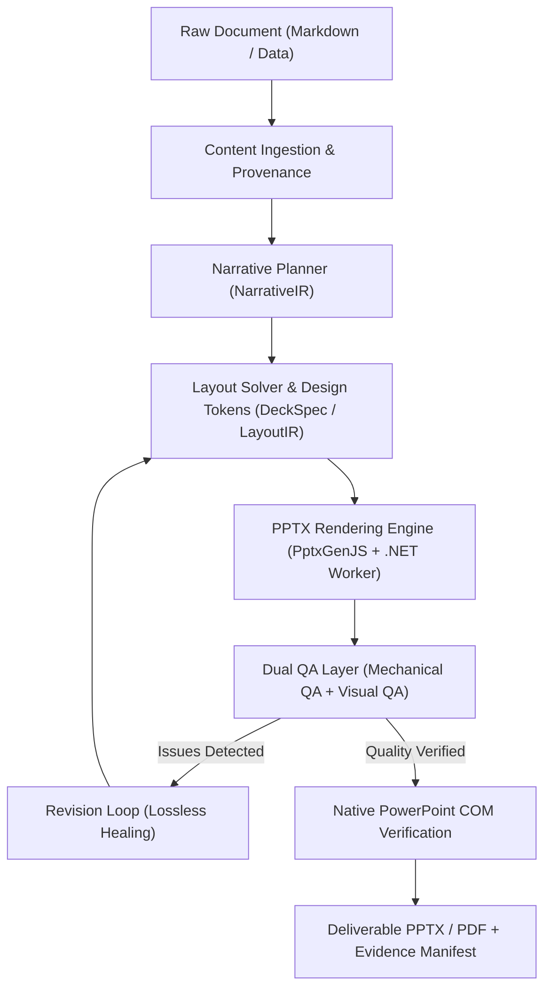

# PresentationOS

<p align="center">
  <strong>The Open-Source Deterministic AI Presentation Engine & Infrastructure</strong>
</p>

<p align="center">
  <a href="#license"></a>
  <a href="#architecture"></a>
  <a href="#testing"></a>
  <a href="#native-office-qa"></a>
  <a href="#intermediate-representations"></a>
</p>

---

## Overview

**PresentationOS** is an open-source development platform and rendering infrastructure that transforms raw markdown and tabular data into enterprise-grade, editable PowerPoint presentations (`.pptx`) with mathematical determinism, **100% factual preservation**, and native Microsoft Office COM verification.

Most AI slide generation tools are brittle wrappers that suffer from hallucination, overlapping text, and unreadable layouts. PresentationOS establishes an extensible operating-system-grade pipeline featuring **multi-tier intermediate representations (IR)**, **constraint-based geometry solving**, and an **automated closed-loop revision cycle**.



---

## Key Highlights

- **Multi-Tier Intermediate Representation (IR)**: Decoupled schemas (`DocumentIR` &rarr; `NarrativeIR` &rarr; `DeckSpec` &rarr; `LayoutIR` &rarr; `RenderIR`) validated against JSON Schema 2020-12.
- **100% Strict Fact Preservation**: Mathematical provenance tracking guarantees zero dropped metrics, dates, or bullet items during layout formatting.
- **Dual QA Architecture**:
  - *Mechanical QA*: 18-point geometric check enforcing canvas bounds, overlap prevention, minimum dimensions, and XML safety.
  - *Visual QA*: Metric-based contrast (WCAG), text density scoring, and rhythm evaluation with automatic revision planning.
- **Native Microsoft PowerPoint COM Verification**: Out-of-process 9-step COM verification pipeline executing real file opening, slide count readback, lossless copy verification, PDF rendering (SaveAs 32), and interactive shape tree inspection.
- **Extensible Worker Protocol (`pres-worker/1`)**: Language-agnostic JSON Lines over stdio protocol supporting TypeScript, Python, and C# (.NET 8) workers with non-blocking exit safety and lifecycle management.

---

## Repository Structure

```text
D:/PresentationOS/
├── apps/
│   └── cli/                      # PresentationOS Unified CLI ('pres')
├── kernel/                       # 15 Core TypeScript Kernel Packages
│   ├── artifact-store/           # SHA-256 CAS content-addressable storage
│   ├── capability-registry/      # Provider resolution graph & fallback ABI
│   ├── durable-workflow/         # SQLite-backed checkpointed workflow runtime
│   ├── mechanical-qa/            # 18-point geometric bounding box audit
│   ├── model-router/             # Multi-provider LLM abstraction & fallback
│   ├── plugin-sdk/               # Isolated plugin runtime & permission guards
│   ├── pptx-editor/              # In-place XML run-level slide modifier
│   ├── pptx-engine/              # Constraint layout solver & PptxGenJS renderer
│   ├── revision-engine/          # Non-destructive slide split & auto-revisions
│   ├── schema-validator/         # JSON Schema 2020-12 validator suite
│   ├── skill-runtime/            # Reusable slide skill compiler & executor
│   ├── telemetry/                # Structured JSONL event telemetry & redact
│   ├── template-dna/             # Visual style, palette, & layout extraction
│   ├── visual-qa/                # Aesthetic density, contrast, & rhythm scorer
│   └── worker-protocol/          # Pres-worker/1 IPC spawner & protocol engine
├── workers/
│   ├── node-worker/              # Node.js capability worker
│   └── powerpoint-dotnet/        # C# .NET 8 PowerPoint Native COM worker
├── tools/                        # Pipeline tools & docs auditor
├── docs/                         # Specifications, DoD, & architectural guide
└── state/                        # Audited project state & backlog governance
```

---

## Quick Start

### Prerequisites

- **Node.js**: v22.0.0 or higher
- **pnpm**: v12.0.0 or higher
- **.NET SDK**: 8.0 (for PowerPoint COM Worker)
- **Microsoft PowerPoint**: (Optional, required for native COM QA verification)

### 1. Installation & Build

```bash
# Clone the repository
git clone https://github.com/bobo123546/PresentationOS.git
cd PresentationOS

# Build all workspace packages
pnpm -r build
pnpm run build:cli
```

### 2. Compile a Presentation with Revision Loop

```bash
# Run compiler with integrated QA and automatic healing
node apps/cli/dist/index.js compile tools/vertical-slice/sample.md
```

### 3. Run Verification & State Audit

```bash
# Run full semantic governance audit across specifications and code
node apps/cli/dist/index.js audit
```

---

## Verification & Testing

Every single component in PresentationOS is rigorously tested. Fake passes and simulated assertions are strictly forbidden by our engineering baseline.

```bash
# 1. Run full TypeScript Kernel test suite (116 passing tests)
pnpm -r --if-present test

# 2. Run Worker Protocol E2E verification
node tests/e2e/worker-protocol.e2e.mjs

# 3. Run C# PowerPoint COM Worker unit tests
dotnet test workers/powerpoint-dotnet/PresentationOS.PowerPoint.sln -c Release

# 4. Run Python Prototype Suite (22 passing tests)
python -B -m pytest 098/tests -v -p no:faulthandler
```

---

## Roadmap

- [x] **Phase 1: Foundation**: Schema/IR v1, Capability Registry, CAS Artifact Store, Durable Workflow SQLite.
- [x] **Phase 2: Vertical Slice**: Markdown &rarr; DeckSpec &rarr; PptxGenJS &rarr; Native PowerPoint COM QA.
- [x] **Phase 3: Automated QA**: Mechanical QA, Visual QA Scorer, Closed-loop Revision Engine.
- [x] **Phase 4: Unified CLI**: Developer commands (`pres compile`, `pres audit`, `pres qa`).
- [ ] **Phase 5: Multimodal VLM QA**: Integrating vision models for subjective aesthetic scoring.
- [ ] **Phase 6: Desktop Host**: Tauri 2.0 + React canvas workspace for interactive editing.
- [ ] **Phase 7: Media Pipeline**: Speaker notes to neural TTS & MP4 synchronized export.

---

## License

This project is licensed under the [MIT License](LICENSE).
